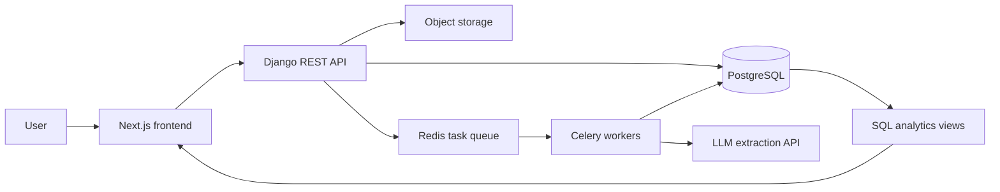

Opacity
AI-assisted invoice processing, approval workflows, and spend intelligence.

Opacity is a finance-operations platform concept that turns invoices into structured, validated records, routes them through configurable approval workflows, and surfaces spending trends and potential anomalies.
Project status: In development. Features below describe the intended scope; update this README as each capability is implemented and tested.

Contents
- Problem
- Planned capabilities
- Architecture
- Technology stack
- Workflow
- Data and evaluation
- Repository structure
- Getting started
- Environment variables
- Development checks
- Security and privacy
- Roadmap
- Documentation
Problem
Invoice handling often combines manual data entry, email-based approvals, fragmented audit records, and spreadsheet-driven reporting. Opacity is designed to bring these steps into one traceable workflow while keeping people in control of exceptions and final approval decisions.
Planned capabilities
1. Invoice intake and extraction
- Upload invoice PDFs and images.
- Extract vendor details, invoice identifiers, dates, line items, tax, totals, and purchase-order references using an LLM-backed extraction service.
- Require structured output against a defined schema.
- Validate extracted fields with deterministic rules, including total reconciliation, date parsing, and GSTIN format checks.
- Flag suspicious or failed fields for human review and allow users to correct the extracted data.
- Record extraction errors and support reprocessing rather than silently dropping failed jobs.
2. Configurable approval workflow
- Model invoice processing as an explicit state machine.
- Route invoices according to configurable rules such as amount, vendor, or cost centre.
- Support approval, rejection with a reason, change requests, and delegation.
- Track approval deadlines and overdue steps.
- Maintain an append-only audit trail of state changes and edits.
3. Controls and anomaly signals
- Flag likely duplicate invoices using vendor, invoice number, amount, and date signals.
- Optionally compare invoices with stored purchase orders.
- Start with explainable vendor-level statistical checks, such as robust z-scores, and evaluate Isolation Forest as an additional detector.
- Store reviewer feedback so detection results can be assessed rather than treating every flag as fraud.
4. Analytics
- Summarise invoice volume, total spend, approval time, overdue items, and approval rates.
- Break spend down by vendor, category, cost centre, and time period.
- Identify workflow bottlenecks and approval workload.
- Provide duplicate/anomaly review views and CSV exports.
- Keep core analytical logic in documented SQL views or materialized views where practical.
5. Administration and access control
- Role-based access for submitters, approvers, analysts, and administrators.
- Vendor master data and basic vendor-name normalisation.
- Seed data for repeatable demos and testing.
Architecture

The frontend communicates with the backend through a REST API. Slow tasks such as document extraction and scheduled analytics run asynchronously. PostgreSQL stores application data and workflow history; original documents are stored separately. The LLM output is treated as untrusted input and validated by application code before it can affect approval decisions.
Technology stack
Area	Planned technology	Purpose
Frontend	Next.js, TypeScript, Tailwind CSS	Application UI and dashboards
Charts	Recharts	Spend and workflow visualisations
Backend	Django, Django REST Framework	API, authentication, permissions, workflow rules
Database	PostgreSQL	Transactional records and analytical queries
Background jobs	Celery, Redis	Extraction, reminders, and scheduled tasks
Document extraction	Claude API with schema-constrained output	Structured invoice-field extraction
Object storage	S3-compatible storage; MinIO for local development	Original invoice files
Testing	Django test tools/pytest, frontend tests, Playwright	Unit, API, and end-to-end coverage
Delivery	Docker Compose and CI	Reproducible local environment and automated checks

Versions should be pinned in the project manifests and updated deliberately.
Workflow
1. A user uploads an invoice.
2. The backend stores the document and queues an extraction task.
3. A worker extracts structured fields and records the result or any failure.
4. Deterministic validation checks totals, dates, required fields, and identifiers.
5. The submitter reviews uncertain fields and corrects errors.
6. The approval rules engine creates the required approval steps.
7. Approvers make decisions; each transition is permission-checked and audited.
8. Analytics views update the dashboard and expose overdue items, spend trends, duplicates, and anomaly flags.
Data and evaluation
Opacity should be evaluated against documented test cases, not just demonstrated with screenshots. The initial evaluation plan is to use a labelled invoice set plus controlled synthetic cases for duplicate and anomaly testing.
Area	Suggested measurement	Reporting note
Field extraction	Exact/normalised field accuracy by field type	Report header fields separately from line items; document the test set
Validation	Catch rate on deliberately invalid records	Describe these as seeded validation cases, not real-world fraud
Duplicate detection	Precision, recall, and F1	Clearly define what counts as a duplicate
Anomaly detection	Precision among top-ranked flags, plus review results	Synthetic outliers do not establish real-world fraud detection performance
Approval workflow	Median simulated time to decision; overdue-step rate	Compare equivalent scenarios and state assumptions
API performance	Latency percentiles at a stated data volume	Record hardware/environment and test method

Publish actual results only after running the evaluation. Do not claim accuracy, time savings, or fraud caught without measured evidence.
Repository structure
A suggested monorepo layout:
opacity/
├── frontend/                 # Next.js application
├── backend/                  # Django project and REST API
│   ├── config/               # Django project configuration
│   └── apps/
│       ├── invoices/         # Invoice intake, extraction and validation
│       ├── approvals/        # Workflow state machine and approval rules
│       ├── analytics/        # KPI endpoints and SQL-backed reporting
│       └── vendors/          # Vendor master data
├── infra/                    # Local infrastructure/configuration
├── docs/                     # Architecture and evaluation notes
├── scripts/                  # Seed data and development utilities
├── compose.yaml              # Local services (when implemented)
├── .env.example              # Documented environment template
├── .gitignore
└── README.md
Adjust this tree to match the actual repository as it develops.
Getting started
Prerequisites
- Git
- Node.js and npm
- Python version pinned by the backend project
- Docker and Docker Compose (recommended for local services)
- An LLM API key only if using live extraction; demo mode should work without one
Local setup
The exact commands depend on the files present in the repository. Once the frontend, backend, and Compose configuration have been added, the intended quick start is:
# Clone the repository
 git clone <repository-url>
 cd opacity

# Create local configuration; keep secrets out of Git
 cp .env.example .env

# Start the services when compose.yaml is available
 docker compose up --build
If the Compose setup is not yet available, run the frontend and backend using the scripts documented in their respective directories. Apply Django migrations and load seed data before testing the workflow. Never commit your real .env file or API credentials.
Environment variables
Keep secrets in local environment variables or an untracked .env file. Document the exact variable names used by the implementation in .env.example.
Variable	Purpose
DJANGO_SECRET_KEY	Django secret key
DJANGO_DEBUG	Enable/disable debug mode
DJANGO_ALLOWED_HOSTS	Allowed hostnames
DATABASE_URL	PostgreSQL connection string, if using URL-based configuration
REDIS_URL	Redis connection URL
ANTHROPIC_API_KEY	Optional key for live Claude extraction
NEXT_PUBLIC_API_BASE_URL	Backend API base URL used by the frontend
AWS_ACCESS_KEY_ID / AWS_SECRET_ACCESS_KEY	Object-storage credentials where required
AWS_STORAGE_BUCKET_NAME	Bucket used for document storage
AWS_S3_ENDPOINT_URL	Optional endpoint for S3-compatible/local storage such as MinIO

These are suggested names, not a guarantee that the current code reads them. Keep this table and .env.example synchronised with the actual configuration.
Development checks
Add and run the checks that match the implemented tooling. The intended baseline is:
- Backend unit and API tests for validation rules, permissions, state transitions, and retries.
- Frontend linting, type checks, and component tests.
- End-to-end test for upload → review → approval → dashboard.
- CI that runs the test suite and static checks on every pull request.
- API schema/OpenAPI documentation for the REST endpoints.
Security and privacy
- Enforce authorisation in the backend, not only in the frontend.
- Validate all extracted fields and treat LLM responses as untrusted input.
- Do not log invoice contents, credentials, or sensitive document data.
- Keep uploaded documents private and serve them through authorised access or expiring signed URLs.
- Explain clearly when a document is sent to an external LLM provider.
- Use synthetic/sample data for demos unless you have permission to process real invoices.
- Use audit logs to support traceability; avoid storing secrets or unnecessary sensitive information in the log payload.
Opacity is a prototype unless and until its security, reliability, and compliance requirements have been independently reviewed. It is not a payment processor or a fraud determination system.
Roadmap
- [ ] Establish frontend/backend scaffold and local development environment
- [ ] Implement authentication and backend role permissions
- [ ] Add invoice upload, document storage, and extraction queue
- [ ] Add schema validation and human correction flow
- [ ] Implement approval state machine, configurable rules, and audit history
- [ ] Add duplicate detection and vendor-level anomaly scoring
- [ ] Build SQL-backed analytics and CSV exports
- [ ] Add automated tests, CI, containerised setup, and deployment
- [ ] Publish measured evaluation results and a short demo
Update the roadmap as tasks are completed; do not mark features complete until they are implemented and tested.
Documentation
Planned supporting documentation:
- docs/architecture.md — component boundaries and key design decisions
- docs/evaluation.md — datasets, methodology, metrics, and limitations
- docs/api.md or generated OpenAPI schema — API contract
- docs/threat-model.md — access control, file handling, and data-flow risks
License
No license has been selected yet. Add a LICENSE file before inviting reuse or contributions, and choose a license appropriate for the project.